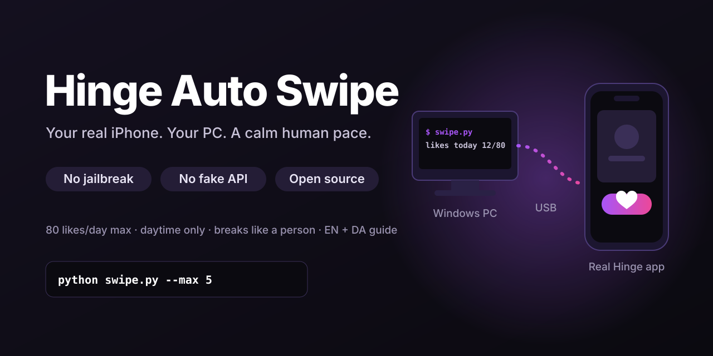

<p align="center">
  <a href="https://byensitmagnus.github.io/hinge-swipe-iphone/"></a>
</p>

<p align="center">
  <a href="https://byensitmagnus.github.io/hinge-swipe-iphone/"><b>Setup guide (EN + DA)</b></a> ·
  <a href="#quick-start">Quick start</a> ·
  <a href="#how-it-works">How it works</a> ·
  <a href="#safety-and-pacing">Safety</a> ·
  <a href="#faq">FAQ</a>
</p>

<p align="center">
  <a href="https://github.com/byensitmagnus/hinge-swipe-iphone/stargazers"></a>
  <a href="https://github.com/byensitmagnus/hinge-swipe-iphone/network/members"></a>
  <a href="LICENSE"></a>
  
  
  
</p>

## Start here

| You have | Go to |
|---|---|
| **An iPhone with Hinge, a USB cable and a Windows PC** | [Download the app](https://github.com/byensitmagnus/hinge-swipe-iphone/releases/latest) (`HingeAutoSwipe-Setup-….exe`), then follow its **Setup** tab. About 10 minutes. |
| **A Mac, or you prefer the source** | The [setup guide](https://byensitmagnus.github.io/hinge-swipe-iphone/), English and Dansk. |
| **A coding agent (Claude Code, Codex, …)** | Point it at this repo and say *"set this up for my iPhone"*. [`AGENTS.md`](AGENTS.md) tells it how. |
| **Just curious** | Read [How it works](#how-it-works), then [Safety and pacing](#safety-and-pacing). |

## How it works

Hinge's own API is locked down, and fake clients get banned fast. This takes the other road: it drives the **real Hinge app on your real iPhone**, the way an app's UI test would.

| Step | What happens |
|---|---|
| **Connect** | Plug the iPhone into the PC. [pymobiledevice3](https://github.com/doronz88/pymobiledevice3) opens a tunnel over USB. No admin rights, no jailbreak. |
| **Install once** | A small signed test app (Appium's [WebDriverAgent](https://github.com/appium/WebDriverAgent), built by `make_ipa.py`) is put on the phone with Sideloadly and a free Apple ID. |
| **Swipe** | `swipe.py` finds buttons **by name** (not by pixel position), taps *Like*, then *Send like*, and waits like a person would. |

Because it reads button names, it keeps working when Hinge shifts its layout around.

## Quick start

**Windows, plug and play:** download **`HingeAutoSwipe-Setup-….exe`** from [Releases](https://github.com/byensitmagnus/hinge-swipe-iphone/releases/latest) and run it. No Python, no admin rights. Windows may say *"Windows protected your PC"* because the app isn't code-signed: click **More info → Run anyway**.

**Mac or from source:** double-click `start.command` (Mac) or `start.bat` (Windows) in the project folder. It installs what it needs and opens the same app in your browser.

In the app, pick a pace, press **Start**, and watch today's count, the pace, the ETA and the live log. Press **Stop** whenever you like. The other tabs:

- **Setup:** a seven-step checklist that checks the phone for you: cable and trust, Developer Mode, the test app, Sideloadly, Hinge and a connection test.
- **History:** likes per day, the last 7 and 30 days, and your best day.
- **Settings:** language (Dansk or English), default pace, allowed hours, your own limits per pace, a daily scheduled start, and Hinge's button names for other languages, read straight off your screen.

| Mode | Pace | Default cap | Risk |
|---|---|---|---|
| **Secure** | 8–18 s between likes, reads most profiles, long breaks | 50/day, 20 min | lowest |
| **Human** | 5–12 s, reads most profiles, 45–120 s breaks | 80/day, 30 min | normal (default) |
| **Fast** | ~8 s per like all in, no profile reading, short breaks | 200/day, 2 h | clearly higher ban risk |

Command line instead:

```powershell
git clone https://github.com/byensitmagnus/hinge-swipe-iphone.git
cd hinge-swipe-iphone/iphone
pip install -r requirements.txt
python make_ipa.py          # builds WebDriverAgentRunner.ipa
# sign + install it once with Sideloadly (free Apple ID): see the guide
python swipe.py --dry       # look, don't like
python swipe.py --max 5     # five likes, then stop
python swipe.py             # a normal 30-minute session (human mode)
python swipe.py --mode secure   # or --mode fast
python app.py               # the app UI (opens in your browser when run from source)
```

Keep the phone **unlocked and in the cable** (set *Settings → Display & Brightness → Auto-Lock → Never*). Stop any time: press **Stop** in the app. On the command line, create an empty file named `STOP` in `iphone/`, or press Ctrl+C.

## What it does

- Likes profiles in Hinge's Discover feed, one after another.
- **Three modes** (`--mode secure|human|fast`, see the table above). Human is the default: 5–12 s between likes, an occasional longer look, a 45–120 s break every 12–25 profiles, some scrolling before each like.
- **Cautious defaults:** 80 likes/day, 30-minute sessions, 08:00–23:00 only. All adjustable (`--daily`, `--minutes`, `--from-hour`, `--to-hour`).
- **Fast path:** fast mode finds the like button directly (~0.2 s) instead of reading the whole screen (~1.7 s), and falls back to the full check when anything looks different.
- Never taps the paid *Send a Rose*. Never sends messages.
- Stops on its own at the daily cap, outside the time window, when the phone locks, or after three unrecognised screens in a row.
- Accepts Hinge's random privacy pop-up so it doesn't block the run.

## Safety and pacing

Automating Hinge is **against Hinge's terms**. Your account can be limited or banned, and no pacing makes that risk zero. That is why the defaults are slow and capped, and why it never touches paid features or messages. Use it on your own account, at your own risk. Not affiliated with Hinge or Match Group. Don't use it to spam or harass anyone.

## FAQ

**Does it need a jailbreak?** No. A stock iPhone is enough.

**Does it cost anything?** No. A free Apple ID signs the test app. The signature lasts 7 days, then you re-sign it with Sideloadly.

**Can it send messages?** Not yet. Automatic first messages to *new* matches are planned; they need a real new match to build against safely.

**Is my password sent anywhere?** No. Nothing leaves your PC. The script talks to your phone over USB and to nothing else. Read [`swipe.py`](iphone/swipe.py) and [`wda.py`](iphone/wda.py): a few hundred lines in total. Settings, the daily counter and the test app stay on your PC (`%LOCALAPPDATA%\HingeAutoSwipe` for the installed app).

**It's in Danish?** The app speaks Danish and English. Hinge's button names follow your phone's language, and the defaults are Danish. For another language open Discover in Hinge, then go to **Settings → Button names → Read the screen** and click the right names.

**macOS or Linux?** Run it from source (`start.command` on a Mac). pymobiledevice3 runs there too, so it should work, but only Windows 11 is tested so far. Reports welcome.

**Android?** Not supported. This uses Apple's UI-testing stack.

## Tested on

Windows 11 · iPhone 17 (iOS 27.2) · Python 3.11 (source) and 3.12 (Windows app) · pymobiledevice3 11.61 · Appium WebDriverAgent v16.15.3 · Hinge with a Danish interface.

## Repository layout

| Path | What |
|---|---|
| `iphone/` | The iPhone swiper (Python): use this |
| `packaging/` | The Windows app: PyInstaller spec, Inno Setup installer and `build_windows.ps1` |
| `docs/index.html` | Step-by-step setup guide, English + Dansk |
| `experimental/rust-api-client/` | Older idea: an unofficial Hinge API client in Rust. Unverified against a real account; kept for reference |

```powershell
cd iphone
python -m unittest discover -s tests    # unit tests
```

Build the Windows app and installer with `powershell -ExecutionPolicy Bypass -File packaging\build_windows.ps1` (needs uv or Python 3.12, and Inno Setup 6). Pushing a `v*` tag builds it on GitHub Actions and attaches the installer to the release.

## Contributing

Bug reports and pull requests are welcome, especially: more languages for the button names, macOS/Linux notes, and a safe first-message flow. See [CONTRIBUTING.md](CONTRIBUTING.md). Found a security problem? See [SECURITY.md](SECURITY.md).

## License

MIT, see [LICENSE](LICENSE). Made by [Byens IT](https://github.com/byensitmagnus).
